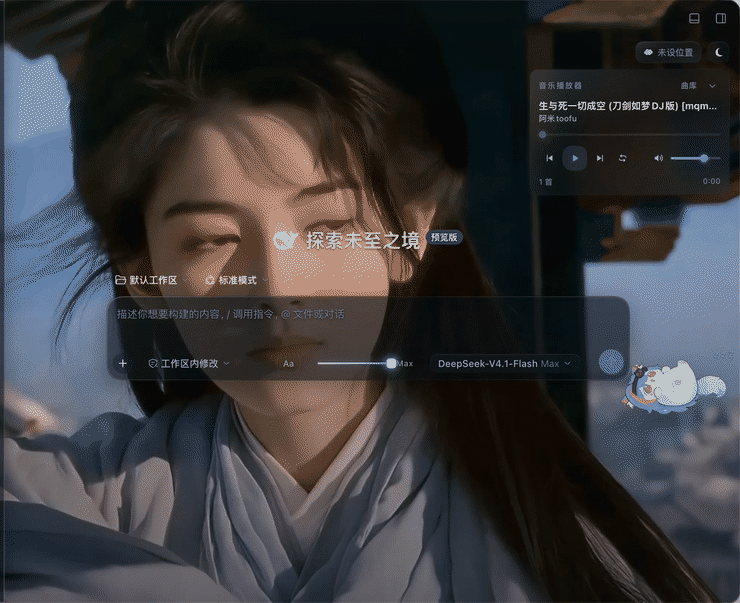

# Runlang

*庭院动态壁纸 · 烟熏玻璃面板 · 右上角音乐播放器（静音 / 音量 / 顺序循环随机 / 拖动进度）· 薄荷小猫桌宠 · 壁纸库与角色中枢素材上传。动图是「新会话」界面的真实录屏（左侧会话列表涉及隐私，已裁掉）；完整 UI 大图见 [截图](docs/screenshot.png)。*

Runlang 是天光 2.3.0 的独立本地分支。使用你提供的庭院短片作壁纸，搭配冷白文字、青蓝点缀和深色烟熏玻璃。保留壁纸面板、浅深色切换、玻璃档位和薄荷小猫桌宠；默认关闭开场长片，打开界面即看壁纸。

## 使用

1. 在 DSH 插件管理中关闭天光及其他全局皮肤，启用「Runlang」，然后刷新当前界面。不需要卸载天光。
2. 按 **Alt+W**（macOS 为 **⌥W**）或点击窗口边缘的壁纸按钮，打开壁纸面板。可在其中换壁纸或暂停动态播放。
3. 右上角的「音乐」胶囊（或展开的播放器）用于播放本机音乐；第一次启用后需要重启一次 DSH 让音乐路由生效，之后按需添加曲目即可。
4. 想回到天光，停用Runlang、启用天光，再刷新。两者的壁纸和插件设置分别保存；DSH 自身的浅深色偏好是共用的。

## 角色中枢 → 素材上传（v1.1.1）

桌宠菜单打开「角色中枢」，里面有张「素材上传」卡片，换背景和换音乐不用再翻面板：

- **壁纸（图片 / 视频）**：选一个文件，上传后**立即应用为全屏壁纸**，同时加入壁纸库（「打开壁纸面板」可继续做标签/轮播）。
- **音乐（可多选）**：上传后直接进曲库，并开始播放第一首；「打开曲库」跳到壁纸面板的音乐分区。
- 文件仍存进 DSH 配置目录（`<profile>/runlang/uploads`），和面板上传是同一份素材；上限沿用宿主设置（默认 512MB）。

## 音乐播放器（v1.1.0）

右上角、天气胶囊下方是迷你播放器。卡片上有播放/上一首/下一首、进度条、**静音按钮**和**音量滑块**；
点右上角的箭头收起，收起后剩一枚「音乐」胶囊。音量、静音、展开状态与上次曲目都会记住。

- **打开曲库**：点播放器卡片右上角的「**曲库**」按钮（会自动打开壁纸面板并展开「音乐」分区，等同 ⌥W / Alt+W → 「音乐」）。
- **添加音乐**：在「音乐」分区点「添加音乐」，可多选 mp3/m4a/aac/flac/wav/ogg/opus/aiff。
  文件存进 DSH 配置目录（`<profile>/runlang/uploads`），刷新或重启都不会丢。
- **扫描 ~/Music**：默认读取 `~/Music` 第一层的音频文件；也可以在同一个分区里添加其他绝对路径（最多 12 个）。
- **播放模式（v1.2.0）**：播放器控制条上多了一个模式按钮，点一下在 **顺序播放 → 列表循环 → 随机播放** 之间切换（悬停有说明）；
  壁纸面板的「音乐」分区里也有三个文字按钮。默认「列表循环」；顺序播放到最后一首会停下，随机播放不会立刻重复当前这首。
- **时长准确（v1.4.3）**：曲库列表现在由宿主直接解析音频容器（OGG/Vorbis、Opus、FLAC、WAV、MP3、M4A）得到总时长，
  播放前就显示正确长度；Chromium 对只缓冲了一部分的 OGG/Vorbis 会报出很短的时长（重启后常见），现在以宿主值为准。
- **进度条与拖动（v1.3.1）**：播放时按动画帧采样 `currentTime`（不再等 `timeupdate` 的 4Hz），时间与进度条取自同一个采样、
  填充色精确停在滑块圆点下方；**可以直接拖动进度条改变曲目位置**（拖动时预览目标时间，松手才真正跳转，点击任意位置也可跳转）。
  另外修了 VBR MP3 / 无时长头文件在 Chromium 里 `duration = Infinity` 导致进度条停在 0:00 的问题（改用 seekable/buffered 的长度）。
- **重启一次**：音乐路由是插件宿主半的一部分，旧的 DSH 进程里没有它。第一次更新后重启一次 DSH，
  之后播放器才能读到曲库（界面会提示「退出并重新打开一次 DeepSeek Harness」）。

> 说明：面板里的「添加音乐」走宿主已有的上传通道，因此中文文件名会被存成 ASCII 安全名（如 `upload-xxxx.mp3`），
> 播放器和面板仍显示原始文件名。

## 数据与文件位置

所有素材和设置都在 DSH 配置目录的 `runlang/` 下（桌面版默认 profile 叫 `desktop`）：

| 路径 | 内容 |
|---|---|
| `~/.dsh/profiles/desktop/runlang/uploads/` | **壁纸和音乐素材**都在这里（同一份素材）。面板上传、角色中枢上传都落到这个目录，刷新/重启不丢。 |
| `~/.dsh/profiles/desktop/runlang/music-roots.json` | **音乐文件夹配置**（在壁纸面板「音乐」分区添加过文件夹才生成；删掉它即回到默认 `~/Music`）。 |
| `~/.dsh/profiles/desktop/runlang/state/settings.json` | 皮肤设置（壁纸选择、玻璃档位、音量/静音、模块开关等），宿主同步的那一份。 |

补充：

- 换用别的 profile 时，把 `desktop` 换成对应目录名；界面诊断里显示为 `$DSH_HOME/profiles/desktop/runlang`（`/skin-qinglan/_engines` 的 `data.dir`）。
- 从 1.3.x 升级时，旧的 `qinglan/` 目录会**一次性复制**到 `runlang/`（旧目录保留，回退仍可用）。
- 停用或卸载 Runlang**不会删除**这些文件；想彻底清空就手动删除 `runlang/` 目录。
- `~/Music` 只是默认扫描位置，插件不会修改或复制它。

## 素材与许可

内置 MP4 为 1920×934、30 fps、H.264、无音轨。由用户提供的「浮生梦影 AI」短片裁切、减速并在接缝处交叉淡化得到，循环长 3.3 秒。感谢 [天光项目](https://github.com/MilkySnowWay123/dsh-client-ui-skin-tianlight)；原代码版权及 MIT 声明保留。代码沿用天光项目的 MIT 许可；内置视频与桌宠图由本项目作者提供并授权随本仓库公开（不在 MIT 代码许可范围内，转载或商用前请先征得作者同意）。

## License

- **Code**: MIT (see [LICENSE](LICENSE)); it is a local fork of the [Tianlight](https://github.com/MilkySnowWay123/dsh-client-ui-skin-tianlight) project, whose copyright notice is kept.
- **Bundled assets**: `assets/runlang-loop.mp4` (the author's courtyard clip, cut to a 3.3 s muted loop) and `assets/cat.png` (the pet artwork) are the author's own assets and are published with this repository with permission. They are **not** covered by the MIT license; ask the author before redistributing them commercially.
- **Third-party components** are listed in [docs/THIRD-PARTY.md](docs/THIRD-PARTY.md).
